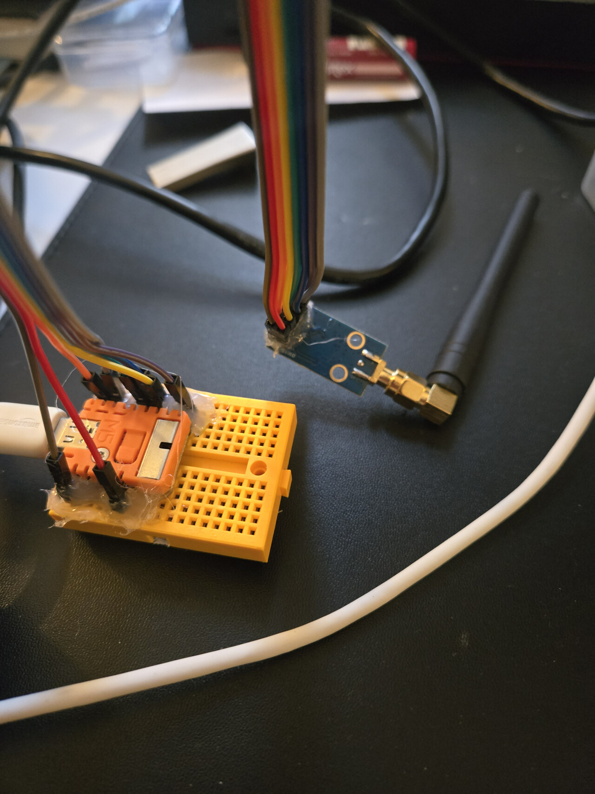
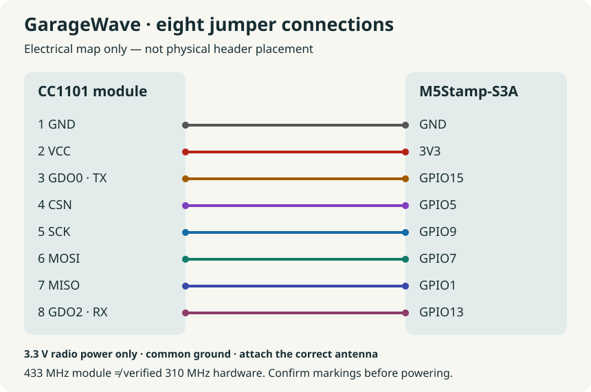

# GarageWave

**Two chips. Eight jumper wires. One smart garage door.**

I built GarageWave to bring my old Stanley garage door into Home Assistant.
The hardware is an ESP32, a CC1101 radio and eight jumper wires. ESPHome handles
the radio command, and a separate Zigbee tilt sensor tells Home Assistant whether
the door is open or closed. My original remote still works, and I didn't have to
modify the opener.

This works on my legacy Stanley fixed-code garage. The current profile is written
for that opener type. It should be straightforward to adapt to other compatible
fixed-code openers or RF devices: keep the wiring and packages, then configure the
right frequency, modulation and signal for your remote. That doesn't mean every
Stanley model or device on the same frequency will work. Rolling-code systems
need a different approach. See [protocols and extension ideas](docs/rf-protocols.md).

My garage code stays private. The examples here start with transmission disabled
so you can set up the device before adding your own signal. They pass configuration
checks and compile; see [testing](docs/validation.md) for what those checks cover.

## The build

I used an M5Stamp-S3A, a CC1101 module, a mini breadboard, jumper wires and USB
power. I already had the M5Stamp and USB power; the radio was $8.99. A THIRDREALITY
Zigbee Smart Garage Door Tilt Sensor connects separately to Home Assistant through
Zigbee. The board and radio total $16.49, with the remaining parts listed in
[parts and prices](docs/hardware.md).

The Stanley setup targets approximately 310 MHz. Check the exact radio variant
and antenna before buying: a CC1101 chip's tuning range doesn't mean a module
sold for 433 MHz will perform properly at 310 MHz.

*Here's the assembly. The wiring map below is easier to follow than the wires
under the glue.*

| CC1101 reference pin | M5Stamp-S3A |
|---|---|
| 1 GND | GND |
| 2 VCC | 3V3 |
| 3 GDO0 (TX) | GPIO15 |
| 4 CSN | GPIO5 |
| 5 SCK | GPIO9 |
| 6 MOSI | GPIO7 |
| 7 MISO | GPIO1 |
| 8 GDO2 (optional RX) | GPIO13 |

Use 3.3 V radio power and signaling, never 5 V. Verify the exact module's pin
numbers, orientation and markings before applying power; this is not a universal
physical pinout. [Wiring details](docs/wiring.md).

## Start here

1. Check module, antenna, remote frequency and fixed-code compatibility.
2. Wire with power disconnected and attach the correct antenna.
3. Install ESPHome **2026.10.1**, clone/download this project, and follow
   [getting started](docs/getting-started.md) to configure private credentials.
4. Flash over USB with transmission disabled; check Wi-Fi, API and SPI logs.
5. Identify your own authorized remote's signal, configure it only in an ignored
   local file, and perform a supervised RF test. No Stanley waveform is included.
6. Pair the independent tilt sensor; observe its actual open/closed polarity.
7. Install the [Home Assistant package](home-assistant/garage-cover.yaml), replace
   entity IDs, and test the cover with the physical garage in sight.

ESPHome exposes **GarageWave Transmit**, a momentary button backed by one shared
script. Home Assistant combines it with the sensor to request open only from
closed and close only from open. Unknown sensor state and offline transmission
block cover requests. A 30-second lockout drops duplicates rather than queueing
them; measure travel time and adjust it. A tilt sensor cannot establish precise
position, obstruction or whether the door is still moving. There is no stop action
or automatic retry. [Integration and behavior](docs/garage-door-integration.md).

## Documentation

- [Installation and private RF customization](docs/getting-started.md)
- [Hardware, bill of materials and compatibility](docs/hardware.md)
- [Wiring](docs/wiring.md)
- [Home Assistant and sensor setup](docs/garage-door-integration.md)
- [Protocols and other RF applications](docs/rf-protocols.md)
- [Troubleshooting](docs/troubleshooting.md)
- [Security, physical safety and RF rules](docs/security-and-safety.md)
- [Validation and remaining tests](docs/validation.md)
- [Sharing, contributing and release preparation](docs/releasing.md)

## Safety and security

Use only equipment you own or are authorized to control. Fixed-code remotes are
replayable; ESPHome does not fix that. Keep actual RF codes, captures, DIP settings
and credentials private. Do not expose the controller directly to the internet;
use authenticated Home Assistant access and encrypted ESPHome API connections.
Never disable safety beams or obstruction detection. Transmission does not prove
movement; do not retry a command automatically. Exercise caution with unattended
closing. Respect local RF rules, including applicable U.S. FCC Part 15 requirements
such as [47 CFR §15.231](https://www.ecfr.gov/current/title-47/chapter-I/subchapter-A/part-15/subpart-C/section-15.231).
A configured frequency, power or cooldown alone does not establish compliance.
This hobby project comes without warranty; verify suitability for your equipment.

## Contributing

Small documentation fixes and reproducible compatibility reports are welcome.
Include module markings, antenna, ESPHome version and exactly what you tested.
Remove credentials and access waveforms from logs and screenshots. Run the checks
in [validation](docs/validation.md) before sending a change. MIT licensed; built
on [ESPHome](https://esphome.io/) and [Home Assistant](https://www.home-assistant.io/).
Their software, documentation and trademarks belong to their respective owners;
no custom radio driver or third-party source code is vendored here.
